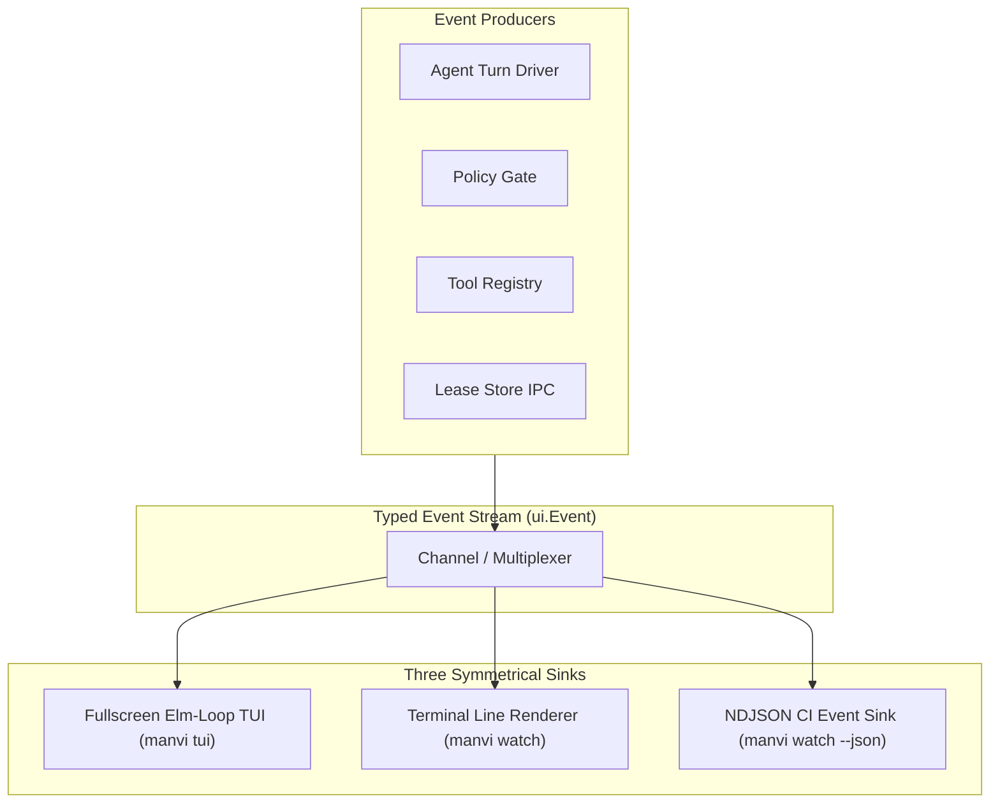
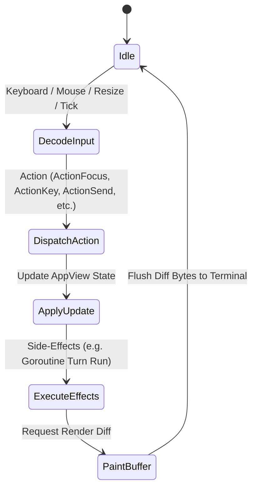
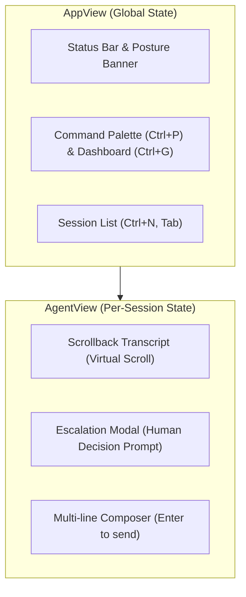
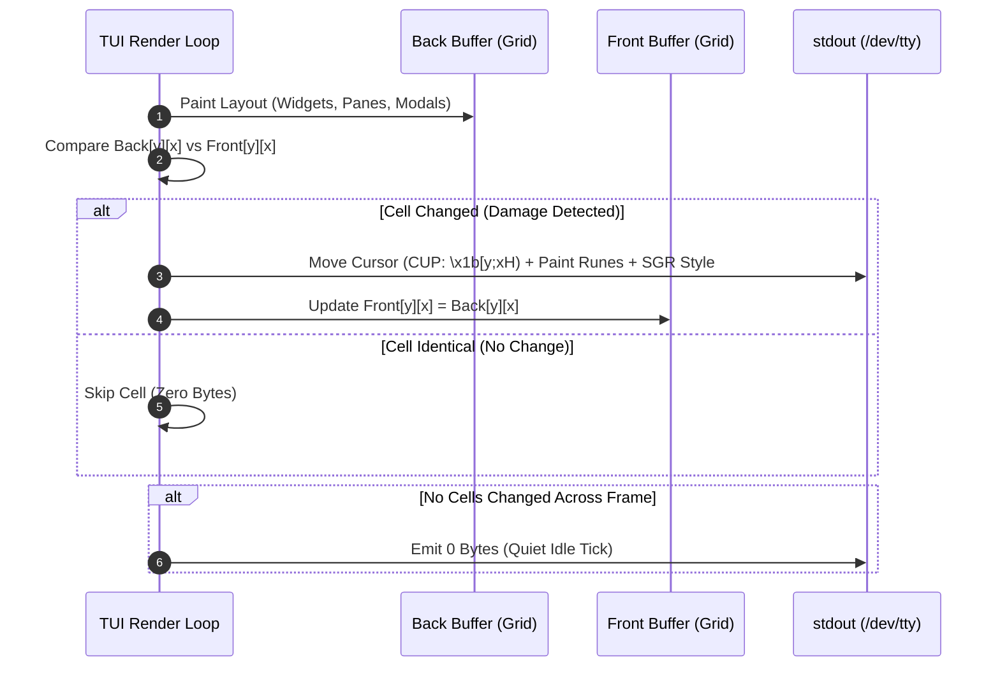
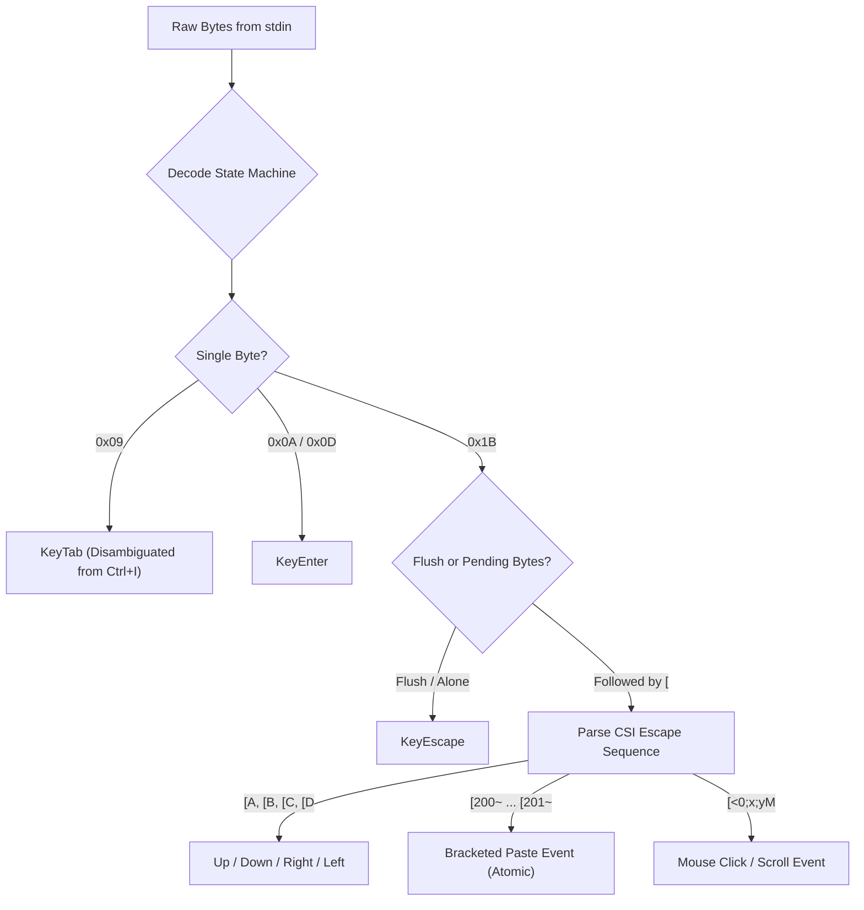
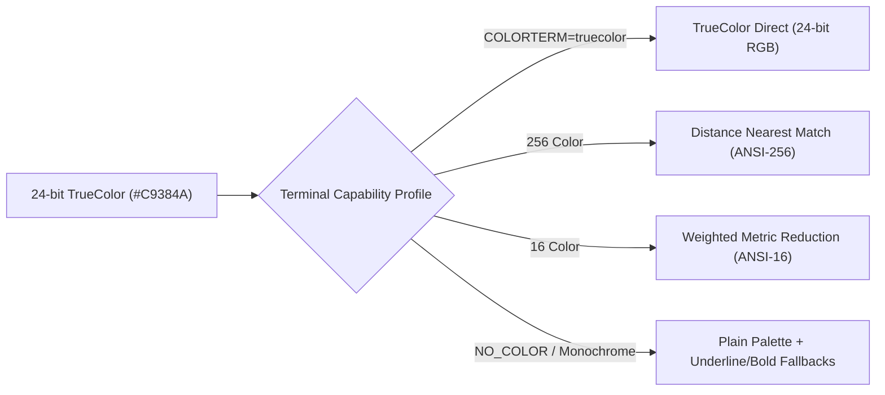
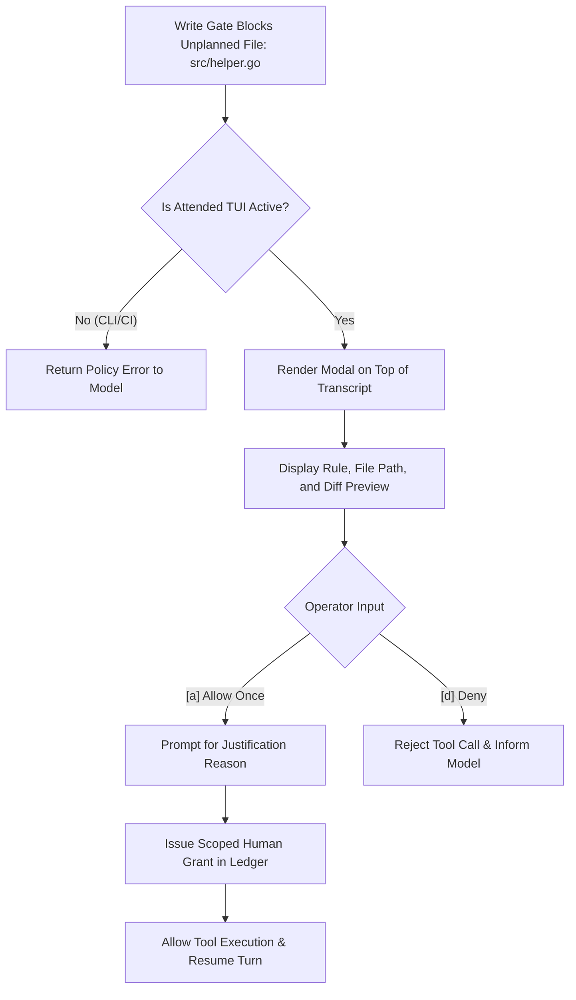

# MANVI Terminal UI & Event Subsystem Specification

This document details the telemetry pipeline, terminal rendering engine, Elm-style TUI state machine, and raw input decoders in **MANVI**.

---

## 1. Unified Event Wire Architecture

All telemetry in MANVI originates as a strongly-typed `ui.Event` stream. The terminal UI, streaming line renderer, and CI NDJSON sink consume the exact same events.



### The `ui.Event` Payload

The JSON names are the wire contract a CI job reads, so they are shown here
rather than only the Go names. `manvi/internal/contract` re-reads this block
against `manvi/ui/event.go` on every run; a field added, renamed or retagged in
one and not the other fails the suite.

```go
type Event struct {
    Kind Kind      `json:"kind"`
    At   time.Time `json:"at"`

    // Agent names the sub-agent an event came from, empty for the parent turn.
    // Two agents' evidence in one stream is only readable if each line says
    // whose it is.
    Agent string `json:"agent,omitempty"`

    Text   string `json:"text,omitempty"`
    Detail string `json:"detail,omitempty"`

    // Tool fields.
    Tool      string          `json:"tool,omitempty"`
    Arguments json.RawMessage `json:"arguments,omitempty"`
    IsError   bool            `json:"is_error,omitempty"`

    // Policy fields. Rule is set whenever a rule fired, including on a success
    // the posture or a grant allowed — a qualified pass is not a clean one.
    Rule       string   `json:"rule,omitempty"`
    Severity   string   `json:"severity,omitempty"`
    Path       string   `json:"path,omitempty"`
    Grantable  bool     `json:"grantable,omitempty"`
    GrantID    string   `json:"grant_id,omitempty"`
    GrantedBy  string   `json:"granted_by,omitempty"`
    Demoted    string   `json:"demoted,omitempty"`
    Degraded   []string `json:"degraded,omitempty"`
    Weakened   []string `json:"weakened,omitempty"`
    ApprovalID string   `json:"approval_id,omitempty"`

    // Set only by the NDJSON sink, on a line standing in for an event whose
    // fields would not all marshal. It names what that line is missing, so the
    // transcript carries a hole a reader can see rather than one that looks
    // like an event that never happened.
    EncodeError string `json:"encode_error,omitempty"`

    // Session fields.
    TaskID  string `json:"task_id,omitempty"`
    Posture string `json:"posture,omitempty"`
    Model   string `json:"model,omitempty"`

    // Usage.
    InputTokens  int `json:"input_tokens,omitempty"`
    OutputTokens int `json:"output_tokens,omitempty"`
    // What the priced part cost, in billionths of a dollar, and how many steps
    // no price table covered (non-zero makes the cost a lower bound).
    CostNanoUSD   int64 `json:"cost_nano_usd,omitempty"`
    UnpricedSteps int   `json:"unpriced_steps,omitempty"`
    // The same usage split by the model that spent it.
    ByModel []ModelUsage `json:"by_model,omitempty"`
    // A step.usage event also carries the rest of the step's usage. Its
    // UnpricedSteps is 1 when no price table covered the step.
    ReasoningTokens  int `json:"reasoning_tokens,omitempty"`
    CacheReadTokens  int `json:"cache_read_tokens,omitempty"`
    CacheWriteTokens int `json:"cache_write_tokens,omitempty"`

    // Verify report fields. Bounce is the attempt within the turn; absent
    // means the first.
    Verdict  string   `json:"verdict,omitempty"`
    Source   string   `json:"source,omitempty"`
    Paths    []string `json:"paths,omitempty"`
    Findings []string `json:"findings,omitempty"`
    Bounce   int      `json:"bounce,omitempty"`

    // Diagnostic fields. Type names the session record the event came from and
    // Data is that record's own payload.
    Type string          `json:"type,omitempty"`
    Data json.RawMessage `json:"data,omitempty"`
}

type ModelUsage struct {
    Model            string `json:"model"` // "provider/model"
    InputTokens      int    `json:"input_tokens"`
    OutputTokens     int    `json:"output_tokens"`
    ReasoningTokens  int    `json:"reasoning_tokens,omitempty"`
    CacheReadTokens  int    `json:"cache_read_tokens,omitempty"`
    CacheWriteTokens int    `json:"cache_write_tokens,omitempty"`
    CostNanoUSD      int64  `json:"cost_nano_usd,omitempty"`
    UnpricedSteps    int    `json:"unpriced_steps,omitempty"`
}
```

### Reading the per-model usage line

Every finished turn emits one `turn.usage` event covering the turn's own agent
**and every sub-agent it dispatched**. Children can run on models other than
the parent's (a role's `model` placement), and the same thousand tokens cost
several times more on one model than another, so a token total alone cannot be
turned into money. The event therefore carries the split.

In the terminal it reads like this:

```text
  14500 in / 1450 out tokens
    cost at least $0.09 (3 step(s) unpriced) across 3 models:
    anthropic/claude-opus-5-5 · 1500 in / 150 out · $0.08
    anthropic/claude-haiku-5-5 · 4000 in / 400 out · cache 0 read / 300 written · $0.01
    local/qwen3 · 9000 in / 900 out · unpriced (3 step(s), no price table)
```

and with a single model it is one line under the token count, for example
`cost $0.02 · anthropic/claude-opus-5-5 · cache 1000 read / 200 written`.

- **The first line** is the total: every token the turn and its children
  consumed. It is the same figure the event's `input_tokens`/`output_tokens`
  carry.
- **`cost`** is the sum of every step's charge. Each step is priced on its own,
  from its model's own table (`budget.Prices`, the same table and arithmetic the
  spend cap uses), as its response arrives. Pricing per step matters: a table can
  switch to long-prompt rates on the size of one request, and pricing the
  summed usage would put short requests on the long rate.
- **`at least $X (N step(s) unpriced)`** means some steps ran on a model with no
  price table here — a local server, or a model the table does not list. Their
  tokens are counted; their cost is not known, so the figure is a lower bound.
  **`unpriced`** on a row means none of that model's steps could be priced. It
  is never shown as `$0.00`, because that would read as free.
- **One row per model**, keyed `provider/model`. The parent's own share and any
  children on the same model are merged into one row; what the children spent in
  total is also written to stderr by `manvi run` as `of that, N in / M out was
  spent by sub-agents`. A model is what a tier resolves to, so rows are the
  per-tier split.
- **`cache R read / W written`** is the prompt served from, and written to, the
  provider's cache. Writes are billed above a fresh input token and reads far
  below it, which is why two rows with similar token counts can differ in cost.
- In the TUI the figures are per turn: the session's meter accumulates across
  turns, and each line reports only what changed since the turn began.

On the NDJSON stream the same numbers are `cost_nano_usd`, `unpriced_steps` and
`by_model[]`; `cost_nano_usd / 1e9` is dollars. Each child's own figures, with
its `model`, `cache_write_tokens`, `cost_nano_usd` and `unpriced_steps`, also
travel back to the dispatching agent in the fan-out tool's per-child `usage`.

### Kinds that exist only on the NDJSON stream

Three kinds are projected from the session log for `manvi run --json` and are
**not drawn** by the line renderer or the TUI (`ui.Kind.WireOnly`). A terminal
already says what they carry: `outcomeNotices` summarises a failed or degraded
check in prose and `turn.usage` prints the cost, so rendering both would say it
twice.

| Kind | From | Carries |
| --- | --- | --- |
| `step.usage` | `step/end` | One step's `input_tokens`, `output_tokens`, `reasoning_tokens`, `cache_read_tokens`, `cache_write_tokens` and `cost_nano_usd`. `unpriced_steps` is `1` when no price table covered the step, and then the cost is not a charge. |
| `verify.report` | `verify/report` | `verdict`, `source`, `paths`, `findings`, `degraded` and `bounce`, for every verdict including `passed`. |
| `diagnostic` | `system/prompt_assembled`, `context/tool_result_compacted`, `context/overflow`, `tool/malformed`, `llm/decoding_compensated` | `type`, the session record's name, and `data`, its payload. For the prompt it holds the included and dropped sections, the token count, the budget and a SHA-256 `digest` of the exact prompt text: a digest that changes between turns means the provider's prompt-cache prefix went cold. A compaction's `data` carries sizes, not the shortened text. |

`step.usage` is deliberately not `turn.usage`. `turn.usage` is one event per
turn covering the turn and its sub-agents, and consumers sum it; the per-step
lines are the breakdown of the parent's own steps and are not to be added to it.
A sub-agent's `step.usage` is not forwarded, because its tokens already reach
the parent's `turn.usage`. Its `verify.report` and `diagnostic` events are
forwarded, labelled with `agent`. A session log written before `step/end` carried
a payload yields no `step.usage`; a payload that cannot be read yields an
`error` event, as every unreadable record does.

---

## 2. The Elm Loop Architecture (`manvi/ui/tui`)

The full-screen TUI implements an Elm-style reactive loop (Input → Action → Dispatch → Effect → State Update), adapted from Grok Build's pager architecture:





### Key TUI Features

1. **Interactive Multi-Session Tab Strip**:
   - Visual tab bar displaying active sessions: `[ 1: S1 (ready) ]` `[ 2: S2 ⠋ ]` `[ + ]`.
   - Real-time status badges: busy spinner (`⠋`), pending human approval (`⚠`), and errors (`✕`).
   - Direct session navigation via `Ctrl+T` / `Shift+Tab` (next / previous), `Ctrl+N` (new session), mouse click hit-testing, and wheel-over-strip cycling.
2. **Live Dynamic Theme Switcher (`/theme`, `Ctrl+Y`)**:
   - Instant live switching between **Dark**, **Light**, and **Plain** (monochrome) themes without restarting the process.
   - Interactive theme picker overlay modal with live palette preview.
3. **Interactive Session Switcher Modal (`/sessions`, `Ctrl+S`)**:
   - Searchable overlay modal displaying all running and idle sessions with task IDs, token counts, elapsed time, and status chips.
4. **Uniform Pointer Grammar (mouse or trackpad)**:
   - Every list surface — palette, pickers, help, dashboard — follows one rule: a left click moves the highlight, a left click on the highlighted row confirms it, and a left click outside a floating surface dismisses it. Hover highlights without stealing the keyboard's selection, and non-left buttons never confirm anything.
   - The wheel scrolls the topmost surface regardless of what is behind it: an open overlay pages, an unanswered approval card moves between its options, the session strip cycles sessions, and only then the transcript scrolls.
   - Hit tests read the geometry the last frame actually drew; session membership changes invalidate the record rather than letting a click land on a removed session's ghost.
5. **Fan-Out-Ready Dashboard (`Ctrl+G`)**:
   - Arrow keys (`↑↓←→`, `hjkl`), page keys, and `g`/`G`/`home`/`end` navigate the session list; the drawn window follows the selection so fleets larger than the screen stay reachable, with overflow cues in both directions.
6. **Settings Picker (`/settings`)**:
   - Searchable overlay listing every setting in the catalogue with its value, origin layer, and mutability scope.
7. **Rich Markdown, Syntax Highlighting & Unified Diffs**:
   - Syntax highlighting for `go`, `rust`, `json`, `bash`, `python`, and `sql` with inset container borders (`┌─ go ─┐` / `└────┘`).
   - Colored diff line rendering (`+` additions in green, `-` deletions in red, `@@` hunk headers in cyan).

### Complete Keyboard Shortcuts Reference

| Shortcut | Scope | Action |
|---|---|---|
| `Ctrl+P` | Global | Open Command Palette / Fuzzy Tool Action Picker |
| `Ctrl+N` | Global | Spawn new concurrent agent session tab |
| `Ctrl+X` | Dashboard | Close the highlighted agent session |
| `Ctrl+S` | Global | Open Interactive Session Switcher Modal |
| `Ctrl+Y` | Global | Open Live Theme Switcher Modal (`/theme`) |
| `Ctrl+G` | Global | Toggle System Telemetry Dashboard & Active Lease Inspector |
| `Ctrl+T` / `Shift+Tab` | Navigation | Cycle to the next / previous session |
| `Tab` | Navigation | Cycle focus between composer and transcript |
| `PgUp` / `PgDn` | Overlays & Dashboard | Page through long lists |
| `←→` / `h` / `l`, `g` / `G` | Dashboard | Step through sessions, jump to first / last |
| `Enter` | Composer | Send prompt / Confirm modal decision |
| `Ctrl+C` | Agent Turn | Cancel currently executing turn (releasing all held leases) |
| `Ctrl+Z` | Shell | Suspend TUI and restore host terminal |

---

## 3. Zero-Allocation Damage-Diffed Painter

Unlike terminal libraries that redraw the entire screen on every frame, MANVI's painter maintains two in-memory cell grids: `front` (currently displayed on terminal) and `back` (newly computed layout).



### Benefits

- **Zero Flicker**: No full-screen clear codes (`\x1b[2J`) during normal updates.
- **Minimal Bandwidth**: Idle ticks write exactly 0 bytes over SSH connections.
- **Accurate Widths**: Full East Asian Width (Ambiguous / Fullwidth) and emoji handling in pure Go.

---

## 4. Pure Go Terminal Input Decoder

Terminal input is decoded as a pure state transition function over raw byte slices: `decode(buf []byte, flush bool) (Event, int)`.



### Ambiguities Resolved by Unit Test

1. **Tab vs Ctrl+I**: Disambiguated in raw mode by tracking modifier state.
2. **Esc vs Arrow Keys**: Lone `0x1B` emits `KeyEscape` only when no CSI bytes follow within the read deadline.
3. **Bracketed Paste**: Multi-line pasted text is parsed as a single `EventPaste` payload, preventing premature submission if the paste contains carriage returns.

---

## 5. ANSI Color Reduction Matrix

MANVI dynamically adapts its color palette based on terminal capabilities:



### ANSI-16 Reduction Finding

Because standard ANSI-16 color conversion metrics are weighted heavily toward green luminance, deep red colors (such as `#C9384A`) collapse to *Bright Black* on 16-color terminals. To maintain legibility of critical UI elements:
- Deep dark red is used exclusively for background filled shapes (tiles, selection bands).
- A lighter, saturated red is used for text, glyphs, and status indicators.
- Under `NO_COLOR`, semantic status states use distinct glyphs (`✓`, `✗`, `⚠`, `⌁`) and ASCII text tags rather than relying on color.

---

## 6. Attended Approver Modal

When a soft rule triggers under `strict` posture in the interactive TUI, execution pauses and presents an approval dialog:



---

## 7. Related Documentation

- [Documentation Index](README.md)
- [Why MANVI is Different (Comparison)](COMPARISON.md)
- [Technical Architecture Specification](ARCHITECTURE.md)
- [Policy & Safety Engine Specification](POLICY_AND_SAFETY.md)
- [CLI & Configuration Reference](CLI_AND_CONFIGURATION.md)
- [Hardening Ledger & Defects](HARDENING_LEDGER.md)

